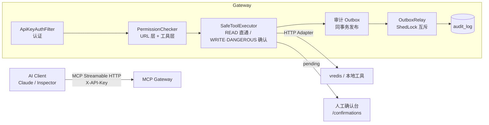
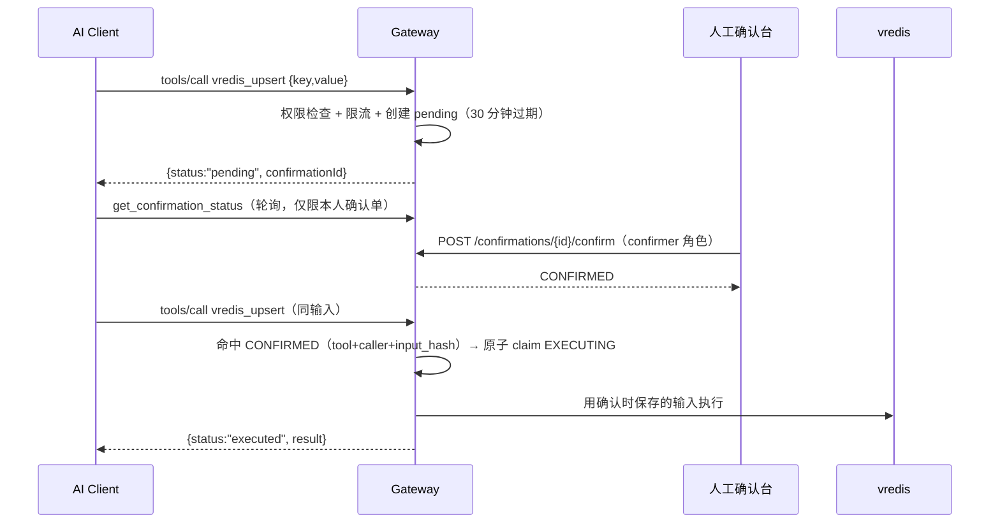

# mcp-tool-gateway — MCP 工具网关与安全沙箱

把 MCP Server 的"裸奔"工具调用变成可控流量。AI 客户端仍然用标准 MCP 协议（Streamable HTTP）
连接网关，但每个工具调用都会经过 **API Key 认证 → 权限矩阵（URL 层 + 工具层 + 租户）→ 副作用分级
（READ 直通 / WRITE·DANGEROUS 人工确认）→ 限流 → 事务性审计**多道闸门；审计经 Outbox 异步落库，
与业务同事务提交，保证不丢。


## 特性

- **动态工具注册**：工具目录以数据库为唯一事实来源，运行时注册/下线无需重启；
  远程 upstream 的工具自动联邦进来（`{upstream}__{tool}`），AI 看到一张统一清单
- **两层权限 + 租户隔离**：API Key 认证（库内只存 SHA-256 哈希）+ RBAC 角色 + `requiredTenant`；
  拒绝按 MCP 语义返回 `isError: true`，不是 HTTP 5xx
- **人工确认状态机**：WRITE/DANGEROUS 工具走 `PENDING → CONFIRMED → EXECUTING → EXECUTED`；
  确认单与调用方 + 输入指纹（SHA-256）绑定，执行前数据库原子 claim（多实例也只会执行一次），
  确认有效期 30 分钟；确认台凭据（confirmer 角色）与 AI 客户端 Key 隔离
- **事务性 Outbox 审计**：审计与业务同事务提交，投递完成即清理 outbox，敏感字段自动脱敏；
  全程留痕（PENDING / CONFIRMED / EXECUTING / EXECUTED / EXECUTION_FAILED /
  REJECTED / DENIED / RATE_LIMITED / EXPIRED；工具目录与 API Key 的管理操作亦留痕：
  TOOL_REGISTERED / TOOL_UPDATED / TOOL_DELETED、KEY_ISSUED / KEY_DISABLED）
- **限流与熔断**：工具可配 `rateLimit`（tool+caller 每 60 秒配额）；限流后端可选
  `local`（单实例内存，默认）或 `redis`（多实例全局精确配额，gateway.rate-limiter 切换）；
  upstream 联邦带 Resilience4j 熔断 + 超时隔离，不健康 upstream 自动摘除
- **可观测**：Micrometer + Prometheus + Grafana（compose 一键起，预制 dashboard 与告警规则；生产部署建议把 prometheus/grafana 镜像从 latest 固定到具体版本）

## 架构



## 核心能力

- **权限**：两层模型——URL 层（`/admin/**` 需 admin 角色，`/mcp/**` 需认证，`/confirmations/**`
  仅 confirmer）+ 工具层（每个工具声明 `requiredRole` / `requiredTenant`；未注册的工具名一律拒绝）。
- **人工确认**：WRITE / DANGEROUS 工具首次调用返回 `pending + confirmationId`，
  REST 确认/拒绝（幂等），确认后**同调用方 + 同输入**再调用才真正执行；
  执行前原子 claim（`CONFIRMED → EXECUTING`），且执行用的是确认时保存的输入快照（防确认后换参）。
  确认有效期默认 30 分钟（`gateway.confirmation-ttl-minutes` 可调；过期作废由
  `gateway.confirmation-expire-scan-ms` 周期执行，实际作废时点不早于扫描间隔）；
  执行失败退回 CONFIRMED，重试不消耗确认机会。
- **限流**：注册工具时可配 `rateLimit`（每 60 秒允许次数，按 tool+caller 计数）；
  超限返回 `rate_limited` 错误并落 RATE_LIMITED 审计。
- **审计**：每次调用完整轨迹 + 敏感字段脱敏，Outbox 保证"执行了"与"留了痕"原子提交。

## 快速开始

### Docker Compose（推荐）

```bash
./mvnw package -DskipTests       # 打出全部 fat jar（gateway + 2 个 upstream，compose 构建都需要）
cp .env.example .env             # 按需修改
docker compose up -d --build     # PostgreSQL 16 + 网关 + 2 个演示 upstream + Prometheus + Grafana
```

### 本地运行（无 Docker 时 H2 兜底）

```bash
./mvnw spring-boot:run -pl gateway-core -Dspring-boot.run.profiles=h2
```

> 本地无 Docker 时 `./mvnw verify` 也能全绿：H2 集成测试必跑，
> Testcontainers + PostgreSQL 版（真实执行 V1~V4 迁移）在 CI 上必跑、本机自动跳过。

> 宿主机端口被占用时（如 5432/8080/3000/9090），复制 `.env.example` 为 `.env`
> 并修改对应 `*_HOST_PORT` 变量即可，容器内端口不变。

> **默认只监听本机回环**：compose 的全部端口映射带 `127.0.0.1:` 前缀，局域网/外网不可达
> （PostgreSQL 弱口令、无认证的演示 upstream 不应默认裸奔）。需要从其他机器访问时，
> 把 docker-compose.yml 里对应映射的 `127.0.0.1:` 去掉，并自行做好防火墙与强凭据
> （`DB_PASSWORD`、`GRAFANA_ADMIN_PASSWORD`、`gateway.seed-api-keys=false`）。

MCP 端点：`http://localhost:8080/mcp`（Streamable HTTP，需 `X-API-Key` 头）。

MCP Inspector / Claude Desktop 配置示例：

```json
{
  "mcpServers": {
    "mcp-tool-gateway": {
      "type": "http",
      "url": "http://localhost:8080/mcp",
      "headers": { "X-API-Key": "user-key" }
    }
  }
}
```

API Key 存储在数据库（`api_key` 表，只存 SHA-256 哈希），启动时 `DbApiKeySeeder` 写入开发/测试种子
（`gateway.seed-api-keys=false` 可关闭——暴露在不可信网络的部署必须关闭，然后用管理端点 `POST /admin/api-keys` 发钥：明文仅创建响应返回一次，库内只存哈希；`DELETE /admin/api-keys/{callerId}` 逻辑禁用立即生效）：
`admin-key`（admin+user+confirmer，tenant-a）、`user-key`（user，tenant-a）。确认台（/confirmations）仅
confirmer 角色可访问。生产环境应通过管理工具生成密钥并分发，不要沿用种子 Key。

## REST API 文档

启动应用后访问 http://localhost:8080/swagger-ui.html 查看管理接口、确认接口、审计查询接口的完整 OpenAPI 文档。

## 工具联邦

Gateway 支持把多个远程 upstream MCP Server 的工具聚合到同一个 tools/list（阶段六）：

- **工具清单联邦**：`time__now`、`weather__forecast` 等远程工具以 `{upstream}__{tool}` 命名
  与本地工具合并暴露，AI 看到一张统一清单
- **调用路由**：按工具名自动路由到对应 upstream，结果包装成本地工具同款格式
- **熔断 + 超时隔离**：Resilience4j（熔断 50% 失败率/滑动窗口 10，超时 5s），一个 upstream
  挂掉不影响其他
- **健康检查**：定时 ping（ShedLock 互斥），不健康的 upstream 自动从 tools/list 剔除，
  恢复后自动加回
- **权限与确认统一**：upstream 工具同样注册进 ToolRegistry，副作用按工具名启发式分级
  （delete/remove/purge/drop → DANGEROUS；write/upsert/create/update/deploy/flush → WRITE；
  其余 READ）——WRITE/DANGEROUS 照样进入人工确认状态机且 requiredRole 提升为 admin，
  只读工具按 defaultRequiredRole（默认 user）直通

配置示例（application.yml）：

```yaml
gateway:
  upstreams:
    upstreams:
      - name: time
        base-url: http://localhost:8090/mcp
        enabled: true
      - name: weather
        base-url: http://localhost:8091/mcp
        enabled: true
```

两个演示 upstream（时间、天气）在 examples/ 下，docker compose 已编排。

## 可观测性

Gateway 通过 Micrometer 暴露 Prometheus 指标，Docker Compose 里已包含 Prometheus + Grafana。

启动后访问（端口可在 `.env` 里覆盖）：
- Prometheus: http://localhost:9090
- Grafana: http://localhost:3000 (admin/admin)
- 指标端点: http://localhost:8080/actuator/prometheus
  （compose 部署时指标/健康端点移到内网管理端口 9091，宿主机不暴露，仅 Prometheus 在容器网络内抓取）

包含的指标：
- `mcp_tool_invocations_total`：工具调用次数（按 tool / side_effect / result 分组）
- `mcp_tool_duration_seconds`：工具延迟分布（histogram，P50/P95/P99）
- `mcp_tool_pending_duration_seconds`：pending 等待时长（创建 → 确认）
- `mcp_upstream_invocations_total`：upstream 调用次数（按 upstream / result 分组）
- `mcp_upstream_duration_seconds`：upstream 调用延迟分布
- `mcp_upstream_healthy`：upstream 健康状态（1=健康，0=不健康）
- `mcp_upstream_circuit_breaker_state`：upstream 熔断状态（按 CLOSED/OPEN/HALF_OPEN）
- `mcp_outbox_messages`：审计 Outbox 队列深度（按 PENDING/FAILED；FAILED > 0 说明有审计事件未落库，应告警）

预制的 Grafana dashboard 在 docs/grafana/dashboard.json，随 Compose 自动装配。

## 真实 AI Agent 集成

项目附带一个可运行的 demo agent（examples/agent-demo），用 Spring AI 的 MCP Client 连接 Gateway，完成以下任务：
- 调用 vredis_search 读取数据
- 调用 vredis_upsert 写入数据
- 遇到 WRITE 工具的 pending 状态时自动轮询并确认
- 最后查询审计日志验证完整轨迹

详细说明见 [examples/agent-demo/README.md](examples/agent-demo/README.md)。

## 工具与权限矩阵

| 工具 | 副作用 | requiredRole | requiredTenant | 需人工确认 | 说明 |
|---|---|---|---|---|---|
| echo | READ | — | — | 否 | 连通性自检 |
| get_confirmation_status | READ | — | — | 否 | 轮询 pending 状态（仅限查本人确认单） |
| vredis_search | READ | user | tenant-a | 否 | 键模式检索 |
| vredis_stats | READ | user | tenant-a | 否 | 统计信息 |
| vredis_upsert | WRITE | admin | tenant-a | **是** | 写入/更新键值 |
| vredis_delete | DANGEROUS | admin | tenant-a | **是** | 删除键 |
| time__now | READ | user | — | 否 | [upstream-time](examples/upstream-time) 联邦工具：当前时间 |
| weather__forecast | READ | user | — | 否 | [upstream-weather](examples/upstream-weather) 联邦工具：城市天气（假数据） |

完整版（含 URL 层与默认拒绝规则）见 [docs/permission-matrix.md](docs/permission-matrix.md)。

## 人工确认流程

确认台页面：**http://localhost:8080/confirmation-console.html**（浏览器直接打开，输入含
confirmer 角色的 API Key——种子 `admin-key` 即可；user-key 会显示 403，凭据隔离对页面同样生效）。
页面列出各状态的确认单与完整输入参数，一键确认/拒绝，每 5 秒自动刷新；底层就是下文的 REST API。



## 审计日志

```bash
curl 'http://localhost:8080/admin/audit?callerId=user-1&status=DENIED' -H 'X-API-Key: admin-key'
```

样例（一条 vredis_upsert 的 PENDING 轨迹，注意 password 已脱敏）：

```json
{
  "callerId": "admin-user",
  "tenantId": "tenant-a",
  "toolName": "vredis_upsert",
  "input": "{\"key\":\"k1\",\"value\":\"v1\",\"password\":\"***\"}",
  "output": null,
  "status": "PENDING",
  "durationMs": null,
  "confirmationId": "54f6dfeb-09af-4426-97f3-9adbe1cf1322",
  "createdAt": "2026-09-19T03:20:31Z"
}
```

## 测试

| 层级 | 内容 | 环境 |
|---|---|---|
| 单元测试 | 权限枚举、echo、脱敏器 | 无依赖 |
| H2 集成测试 | 状态机、原子 claim、限流、执行器、审计链路、vredis 端到端（WireMock） | 本地必跑 |
| PostgreSQL 集成测试 | 真实执行 V1~V4 迁移（JSONB/Outbox/ShedLock/API Key）+ 工具目录读写链路 | Testcontainers，CI 必跑、本机无 Docker 自动跳过（业务流 IT 跑 H2） |

## 技术栈

Java 21 · Spring Boot 4.0.x（4.0.8）· Spring AI 2.0.1（捆绑 MCP Java SDK 2.0.0 GA，
跟踪 MCP 2025-11-25 规范）· Spring Security 7 · Jackson 3 · Hibernate 7 / Flyway ·
PostgreSQL 16（本地 H2 兜底）· ShedLock · Testcontainers · WireMock

## 项目结构

```
gateway-core     MCP Server 装配、工具注册框架（DynamicToolRegistry/ExternalToolRegistrar）、
                 确认状态机与安全执行层（confirmation 包）、echo
gateway-security 认证（API Key）、URL 层授权、ToolAction 分级
gateway-audit    审计事件、Sanitizer、事务性 Outbox（Publisher/Relay）、查询 API
gateway-tools    vredis HTTP Adapter 与工具定义 SPI（ToolExecutorResolver）
docs             架构（含 ADR）、威胁模型（STRIDE）、权限矩阵
```

## 已知限制

诚实清单（与代码同步维护）：

1. MCP 2025-11-25 规范下的 SDK 不支持 MRTR / `InputRequiredResult` 重放与 elicitation
   → 人工确认只能 pending + 轮询。
2. 执行语义是"至少一次"：原子 claim 保证同一条确认只被一个请求执行，执行失败退回
   CONFIRMED 后重试，工具实现需幂等（vredis upsert/delete 天然满足）。
3. 审计未做密码学防篡改（WORM/哈希链）；依赖 DB 权限 + 追加式访问模式。
4. 限流是单实例内存固定窗口，多实例部署时全局配额约为 rateLimit × 实例数。

完整分析见 [docs/threat-model.md](docs/threat-model.md)。

## 文档

- [架构与 ADR](docs/architecture.md)
- [威胁模型（STRIDE）](docs/threat-model.md)
- [权限矩阵](docs/permission-matrix.md)

## 路线图（已全部完成）

| 阶段 | 内容 | 状态 |
|---|---|---|
| 阶段零 | 项目骨架 | ✅ |
| 阶段一 | MCP 协议接入 + 工具注册 | ✅ |
| 阶段二 | 权限策略 + 安全认证 | ✅ |
| 阶段三 | 人工确认 + 安全策略执行层 | ✅ |
| 阶段四 | 审计日志（事务性 Outbox） | ✅ |
| 阶段五 | vredis 封装 + 文档完善 | ✅ |
| 阶段六 | 工具联邦（多 upstream） | ✅ |
| 进阶 | Agent Demo / 可观测性 / 原子 claim / 限流 / 租户隔离 / API Key 落库 | ✅ |
